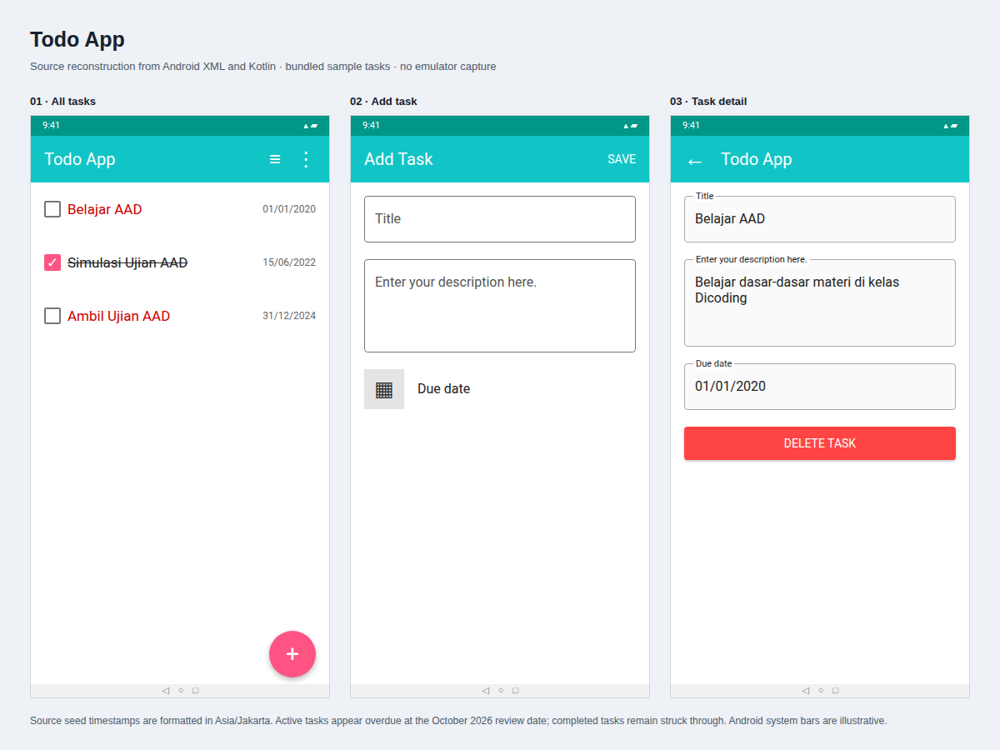
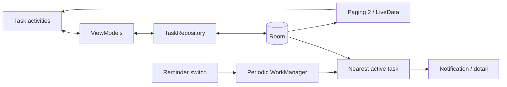

# Todo App

An offline Android task list with due dates, completion status, and an optional daily reminder for the earliest incomplete task.



*Source reconstruction, not an emulator capture. Titles, descriptions, status, and dates use the repository's sample tasks; all dates are overdue at the review date.*

## What it does

- Create tasks with a title, description, and date selected from a date picker.
- Filter all, active, or completed tasks; toggle completion with a checkbox.
- Inspect details and delete tasks, including by swiping the list.
- Distinguish completed titles with a strikethrough and overdue active titles in red.
- Enable or cancel a daily background reminder.

## How it works

XML activities observe ViewModels backed by a repository and Room. Filter-specific SQL supplies a Paging 2 list through LiveData; coroutine writes update task completion and deletion. The database is initially populated from `task.json`.



Periodic work does not specify an exact notification time. Task detail is read-only apart from deletion; no edit or cloud-sync flow is implemented.

## Build

Use the recorded SDK 30 / build tools 30.0.3 and JDK 8 toolchain: Kotlin 1.4.21, AGP 4.1.2, and Gradle 6.5. Minimum Android version: API 21.

```sh
./gradlew assembleDebug
```

The build and Espresso navigation test were not run. Legacy `jcenter()` dependencies and reminder behavior when no active task exists need verification.

[Audited source](https://github.com/ianindratama/TodoListApp/tree/e0229fb12a989eb2316ac921e52e298b8a300bf1). A personal learning project using Dicoding exercise scaffolding; source package names and AAD sample content are preserved.

[Documentation assets and source notes](docs/README.md).
